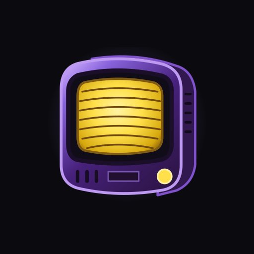

# Fósforo



**Black frame insertion and CRT shaders across Android, without root.**

Fósforo brings the project previously called **BFI** into one app for black frame insertion, CRT and VHS shaders, or both together. Use it with games and emulators that do not offer these effects themselves.

The app is experimental. Development and device testing currently target the **Retroid Pocket Nova running Android 13 at 120 Hz**. Other devices and firmware versions may behave differently.

[Releases and APK downloads](https://github.com/pakovm-git/Fosforo/releases) · [Design guide](docs/DESIGN-GUIDE.txt) · [Testing notes](docs/TESTING.md)

## What it does

- **BFI, shaders, or both:** independent effect switches and one Start/Stop button. BFI inserts black display frames to reduce sample-and-hold motion blur; shaders process the captured screen to reproduce CRT and VHS characteristics.
- **Custom BFI sequences:** edit individual visible/black pairs, including sequences such as `V1-B1 - V2-B1`. The pattern diagram shows every frame separately.
- **System-wide or selected apps:** choose where effects run. Individual apps can inherit global settings or use their own BFI pattern, shader and shader parameters.
- **Shader settings:** browse categories, search, adjust the selected shader's actual parameters, and mark favourites. Thumbnails open a bouncing-ball animation with that shader applied.
- **Libretro library:** explicitly download the complete [Libretro Slang shader repository](https://github.com/libretro/slang-shaders), retaining presets, shader passes, includes and textures in their original directory structure. Categories follow the source repository.
- **Compatibility checks and imports:** compatible standalone `.slang` files and ZIP packages can be imported. Downloads, imports and selection use real on-device shader checks; rejected presets appear in an unavailable-shaders report.
- **Library management:** Bundled contains the curated built-in selection. Favourites appears first when populated, Bundled appears last, and list indicators identify both. Downloaded/imported shaders can be removed while keeping the bundle.
- **Autosave and scoped resets:** valid changes save automatically. Shader defaults reset only the shader parameters being edited, including an individual app's override.
- **Motion tests:** short local animation previews and timed effect sessions with a custom duration, without committing to continuous operation.
- **Quick access:** Start/Stop from the app or Quick Settings; Stop is also available in the running notification. Controller prompts and shortcuts work inside Fósforo and its test screen.

### Curated shader selection

The public 1.0 bundle contains:

| CRT | VHS |
| --- | --- |
| CRT Lottes | VHS and CRT Godot (CC0 core, without font/OSD overlay) |
| Newpixie CRT | |
| zfast CRT Composite | |
| CRT Geom | |

**Shader licensing is separate from the app's MIT license.** The Godot variant retains the unchanged CC0 effect pass and omits its separately sourced font/timecode pass. Mattias CRT, Hyllian Rainbow, Geom Deluxe and NTSC VHS are not bundled because redistribution terms for their exact sources or dependencies could not be confirmed. Download/import support remains available; user-supplied files keep their own terms. Existing private imports are not deleted.

See the [release licensing research](docs/SHADER-RELEASE-LICENSE-RESEARCH.md), [shader sources](docs/SHADER-LIBRARY-SOURCES.md) and [third-party notices](app/src/main/assets/THIRD-PARTY-NOTICES.txt). Inclusion in Libretro's repository does not mean every shader shares one license.

## Interface

Fósforo keeps the app's native Android controls and adopts a CRT-inspired identity: a purple television icon, **Jersey 15** typography, violet structure and phosphor-yellow active accents. It follows the device's light/dark setting.

A slowly moving perspective grid sits behind translucent cards and bars. Landscape uses independently scrolling columns; portrait uses a single-column flow, with a separate shader-parameters view. Shared outlines, rounded shapes, scroll fades and controller prompts keep screens consistent.

Previews are optional: the shader list uses still thumbnails, while the BFI demo stays still until opened. The dedicated test animation runs briefly with the selected effect. There is no beam-simulation mode in this app.

Editable icon and wordmark SVGs are in [assets/branding](assets/branding).

## Requirements and setup

| Platform | Available output |
| --- | --- |
| Android 13+ / API 33+ | Touch-through BFI and CRT processing on compatible devices. CRT requires OpenGL ES 3.1 and firmware that supports excluding Fósforo's own output from capture. |
| Android 8–12L / API 26–32 | Legacy BFI only. Its ordinary overlay can block touches in covered apps. |

BFI requires a reported display refresh rate of **at least 100 Hz**; 120 Hz is the tested configuration. CRT-only operation does not have that BFI refresh-rate requirement.

1. Download an APK from [Releases](https://github.com/pakovm-git/Fosforo/releases) and install it.
2. On first Start, setup lists missing requirements directly, without an introductory acknowledgement. On Android 13+, enable **Fósforo accessibility** for its touch-through output. On older versions, allow drawing over other apps instead.
3. Allow the running notification. Accessibility and notification permission are both required on Android 13+: either order works, and returning to the app shows any remaining requirement. Granting permissions does not start effects. Grant Usage access if using selected-app rules or per-app overrides.
4. Choose Shader, Black frame insertion, or both. Configure the shader and pattern as desired.
5. Press **Start effects**. CRT additionally requests Android's screen-capture consent; BFI alone does not.
6. Use **Stop effects**, the notification's Stop action, or Quick Settings to stop output.

Opening the app or granting a permission does not start effects. On Android 13+, active effects also cover Fósforo itself; touch input continues to work through the trusted overlay on the tested Nova.

## How it works and privacy

On Android 13+, an accessibility service hosts a trusted output overlay. BFI's native blackout layer follows the display's vsync timing and the selected frame sequence.

CRT uses Android's **MediaProjection screen capture** to feed the OpenGL shader pipeline. It still needs capture consent: an overlay alone cannot sample another app's pixels. Fósforo excludes its own output from capture to avoid repeatedly filtering the filtered image. That exclusion relies on a private Android API, so compatibility outside the tested firmware is not guaranteed.

Screen frames are processed **in memory**. Normal operation does not create recordings, save video files or upload captured pixels. Internet access is used for user-requested shader downloads. Installed shader files stay in app-private storage and work offline.

## Current limitations

- BFI flashes and reduces brightness. Avoid it if you are sensitive to flashing images.
- Screen-wide shaders add capture latency, GPU work, memory use and power consumption. Some shader presets deliberately soften or rescale the image.
- Secure/protected content may appear black, and the app cannot provide emulator-internal frame timing or render inaccessible content.
- The Slang implementation supports a subset of RetroArch features. Passing a compatibility check does not guarantee correct appearance or sustained performance for every preset.
- Locking ends CRT capture; restarting CRT requires fresh capture consent. CRT rotation also ends the session. The ineffective **Resume after unlock** control has been removed; automatic unlock resumption is not promised.
- Other Android devices, older Android output, physical controller compatibility and optical panel timing have not received the same verification as the Nova development setup. Software timing reports are not physical-panel measurements.

## Build

Use the checked-in Gradle wrapper, Android SDK platform 36 and Build Tools 36.0.0. The project compiles Java/Kotlin for Java 17; use a JDK compatible with the wrapper and Android Gradle Plugin.

```sh
./gradlew --no-daemon assembleDebug testDebugUnitTest lintDebug
```

On the existing Fedora Silverblue Android toolbox:

```sh
./scripts/verify-in-toolbox.sh
```

The APK is produced at `app/build/outputs/apk/debug/app-debug.apk`. Installation is separate:

```sh
adb install -r app/build/outputs/apk/debug/app-debug.apk
```

Do not commit signing keys, local SDK paths, device logs or generated APKs. See [architecture](docs/ARCHITECTURE.md), [CRT integration](docs/CRT-INTEGRATION.md), [design guide](docs/DESIGN-GUIDE.txt) and [manual UI checks](docs/UI-REDESIGN-MANUAL-CHECKS.md) for implementation details and verification limits.

## Credits and licenses

Copyright © 2026 **PakoVM**. Original app code and original assets: [MIT](LICENSE).

Shaders and dependencies retain their original licenses and notices; they are not relicensed as MIT. Sources, attribution and public-bundle decisions are documented in [THIRD-PARTY-NOTICES.txt](app/src/main/assets/THIRD-PARTY-NOTICES.txt), [shader-library sources](docs/SHADER-LIBRARY-SOURCES.md) and [the Newpixie frame source](third_party/newpixie-frame).

**Jersey 15** is by Sarah Cadigan-Fried / The Soft Type Project Authors, under the [SIL Open Font License 1.1](app/src/main/assets/Jersey15-OFL.txt). Font credits and the license are also available in the app's About section.
