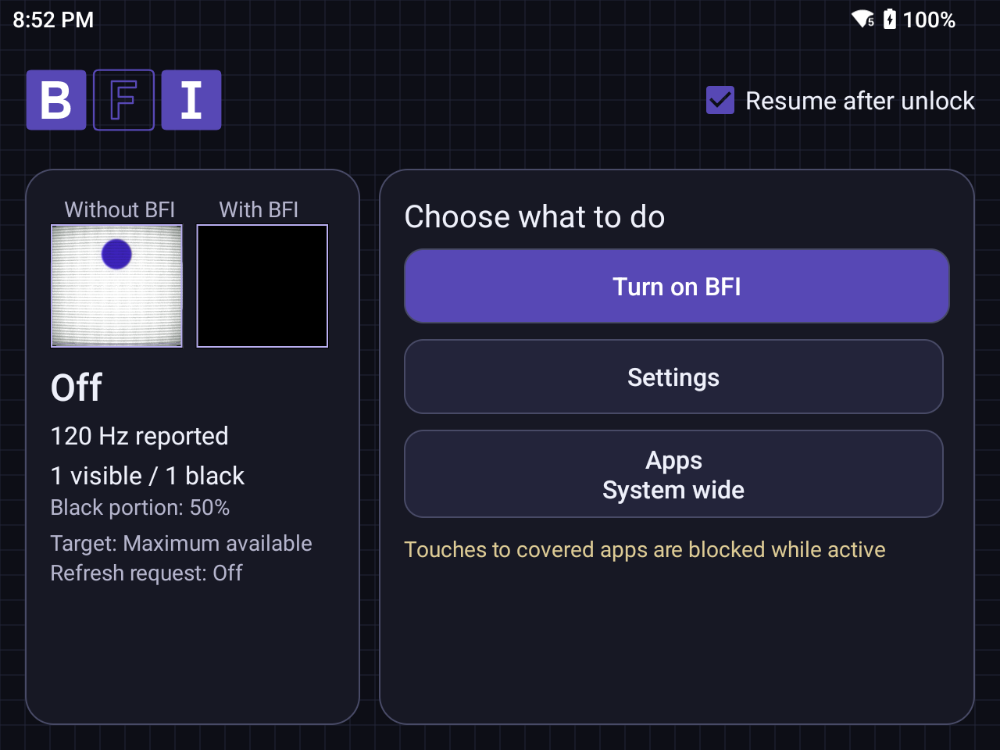

# BFI

An experimental native Android app for black frame insertion across other apps, with customizable frame patterns and app selection.

BFI alternates an opaque black overlay with uncovered display frames. It needs no root or Shizuku. The interface follows the device's light/dark setting and includes synchronized motion previews, a blueprint background, and the framed BFI logo.

## Features

- Continuous operation until stopped, with an optional resume-after-unlock setting.
- Custom patterns from 1–12 visible and 1–12 black slots, with settings applied live.
- System-wide operation or selected apps, with exclusions and per-app overrides.
- Quick Settings toggle, an explicit mode menu, and a foreground notification with Stop.
- Separate timed tests, refresh-rate requests, and local diagnostic reports.
- Automatic settings persistence and scoped Restore defaults.



## Requirements and limits

Android 8.0/API 26 or later. Activation currently requires a **reported refresh rate of at least 100 Hz**. The primary tested device is a Retroid Pocket Nova running Android 13 at a reported 120 Hz.

**BFI causes flashing and reduces brightness.** Read the first-use notice before activating it.

On the tested Retroid, touches to apps covered by the overlay are blocked. System navigation remained usable; controller compatibility needs further device testing. Use the notification or Quick Settings tile to stop output. Android's [overlay input restrictions](https://developer.android.com/reference/android/view/WindowManager.LayoutParams#FLAG_NOT_TOUCHABLE) apply.

This app is experimental. A reported display rate or app callback estimate does not establish physical panel timing, frame presentation, alignment with a game's frames, or improved motion clarity. Refresh-rate requests can be overridden by Android. Only the 1 visible / 1 black pattern at reported 120 Hz has the original user's qualitative system-overlay observation; other patterns need hardware validation.

The CRT appearance in the two motion previews affects those animations only. The app's system overlay applies BFI; it does not apply a CRT shader to other apps.

## Install and use

Version: **0.6.4**, package: `dev.pako.bfi`.

1. Install an APK from [Releases](https://github.com/pakovm-git/BFI/releases). Android may require permission to install apps from the chosen browser or file manager.
2. Open BFI, read and acknowledge the notice, and grant draw-over-apps access. Notifications provide the Stop control. Usage access is requested when app-dependent rules need it.
3. Choose a pattern in Settings and a scope in Apps, then explicitly turn on BFI.
4. Stop from Home, the notification, or the Quick Settings tile. A tile tap toggles the saved preferred scope and Off. Long press opens the mode menu.

While BFI's own activities are visible, the system overlay is suspended and an in-app effect keeps controls usable. Leaving the app resumes the overlay when the current session and rules permit it. Opening the app or granting access does not activate output.

Process death, force-stop, and reboot end activation. Preferences remain saved; the next process starts Off. There is no boot auto-start.

APK signatures matter: an update must use the same package and signing certificate as the installed copy. Debug builds produced on different computers normally have different certificates. Keep signing keys private and never commit them. If Android rejects an update because signatures differ, uninstalling the old copy clears its saved settings; do not do that unintentionally.

## Build

Use the checked-in Gradle wrapper. The project uses Gradle 9.3.1, Android Gradle Plugin 9.1.1 with built-in Kotlin support, Java 17 bytecode, compile/target SDK 36, and Build Tools 36.0.0. Use a Gradle-compatible JDK; the existing development environment uses JDK 25. The Android SDK must have its licenses accepted.

Set `ANDROID_HOME` to the SDK directory, or create an untracked `local.properties` file containing `sdk.dir=/absolute/path/to/Android/Sdk`.

```bash
./gradlew --no-daemon assembleDebug testDebugUnitTest lintDebug
```

On Windows, use `gradlew.bat`. The debug APK is generated at `app/build/outputs/apk/debug/app-debug.apk`. Build success alone does not install or update a device.

For an existing Fedora Silverblue Toolbx with the SDK/JDK configured:

```bash
BFI_TOOLBOX_CONTAINER=android-bfi ./scripts/verify-in-toolbox.sh
```

The helper sources `~/Android/bfi-env.sh` if present and performs checks without installing. It does not create a container or install tools. Installation is a separate action:

```bash
adb devices -l
adb -s YOUR_DEVICE_SERIAL install -r app/build/outputs/apk/debug/app-debug.apk
```

Emergency Stop from an authorized development computer:

```bash
adb -s YOUR_DEVICE_SERIAL shell am force-stop dev.pako.bfi
```

The preview PNGs are committed assets. `scripts/generate-crt-assets.py` is an optional offline generator requiring Pillow and NumPy; neither is needed to build or run BFI.

## Privacy and permissions

The app declares no Internet permission and contains no advertising or analytics SDK. Settings stay in private app storage; diagnostic exports are initiated by the user. Usage access supports foreground-app rules and is not needed for basic system-wide operation without app-dependent rules. Monitoring is bounded and historical, so app selection is not an instantaneous privacy barrier.

The overlay uses a foreground special-use service and a Stop notification. This does not guarantee survival after Android termination or imply Play Store approval. Protected screens and OEM behavior may limit coverage.

## Development

See [architecture](docs/ARCHITECTURE.md), [testing](docs/TESTING.md), and the [design guide](docs/DESIGN-GUIDE.txt). Editable logo and adaptive icon SVGs are in [assets/logo](assets/logo).

Report bugs with the app version, Android version, device model, display mode, selected pattern, scope, and steps to reproduce. Review reports and screenshots for personal information before posting them.

## License and credits

Copyright (c) 2026 PakoVM. BFI source and original assets are available under the [MIT license](LICENSE). Third-party dependencies and the Gradle wrapper retain their own licenses and notices.

The first published APK is an experimental debug-signed build, intended for evaluation. Its signing key is not distributed.
